# 🤖 Dumirror_Robo

<p align="center">
  <a href="https://github.com/VIDAKHOSHPEY22/Dumirror_Robo/releases/download/v1.1.0/Dumirror_Robo-1.1.0.zip">
    
  </a>
</p>

<p align="center">
  <b>An open-source animated robot face library for SSD1306 128×64 OLED displays.</b>
  <br>
  Create expressive DIY companion robots with Arduino and compatible microcontrollers.
</p>

<p align="center">
  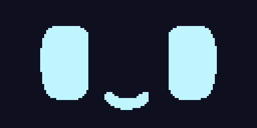
  <br>
  <sub>Animated expressions, built frame by frame.</sub>
</p>

<p align="center">
  <a href="https://VIDAKHOSHPEY22.github.io/Dumirror_Robo/">
    
  </a>
  <a href="https://youtu.be/25PJctTHJlc">
    
  </a>
</p>

<p align="center">
  <a href="LICENSE"></a>
  
  
  
  
</p>

### Quick Download

**[⬇ Download Dumirror_Robo v1.1.0 — ZIP](https://github.com/VIDAKHOSHPEY22/Dumirror_Robo/releases/download/v1.1.0/Dumirror_Robo-1.1.0.zip)**

Download the library directly without cloning the repository. Install the ZIP through Arduino IDE or extract it into your Arduino libraries directory.

**SHA-256 checksum**

```text
8341a0ec37d9391973736abcd651bf4d4ef7d74d2c4fa6c7f2f07913ae6e43ba
```

<sub>Verify the downloaded archive using its SHA-256 checksum. See <a href="https://github.com/VIDAKHOSHPEY22/Dumirror_Robo/releases">all releases</a> for other versions.</sub>

---

## 🎞️ Animation Gallery

Ten frame-based animations bring your robot to life.

### Featured animations

<p align="center">
  
  <br>
  <b>sneeze — Achoo!</b>
</p>

<p align="center">
  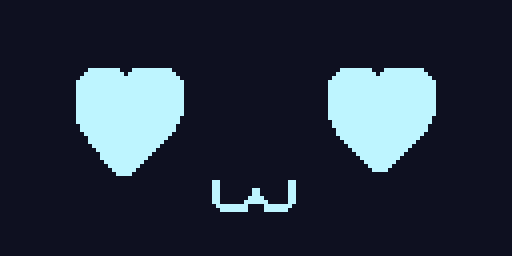
  
  
</p>

<p align="center">
  <b>heartbeat</b> · <b>blink</b> · <b>chew</b>
</p>

### More animations

<p align="center">
  
  
  
</p>

<p align="center">
  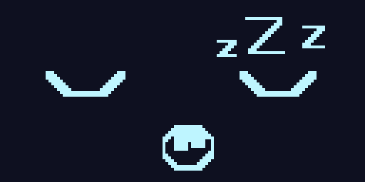
  
  
</p>

### Animation reference

| Name | Frames | Playback | Duration |
|---|---:|---|---:|
| `sneeze` | 6 | One-shot | 1300 ms |
| `blink` | 2 | Loop | 2030 ms |
| `look_left` | 3 | One-shot | 900 ms |
| `look_right` | 3 | One-shot | 900 ms |
| `smile_big` | 3 | One-shot | 1100 ms |
| `heartbeat` | 2 | Loop | 650 ms |
| `sleep_breath` | 2 | Loop | 1400 ms |
| `wake_up` | 4 | One-shot | 1300 ms |
| `hiccup` | 3 | One-shot | 720 ms |
| `chew` | 3 | Loop | 750 ms |

*Durations are approximate and depend on the animation timing configuration and update frequency.*

The GIF previews loop to make the animations easy to inspect. On the device, playback follows each animation's configured loop setting.

A one-shot animation plays once, while a looping animation repeats until it is stopped or replaced.

---

## 🎭 Static Face Gallery

Dumirror_Robo includes 19 built-in static facial expressions.

<p align="center">
  
  
  
  
  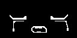
</p>

<p align="center">
  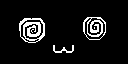
  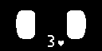
  
  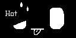
  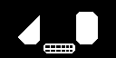
</p>

<p align="center">
  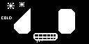
  
  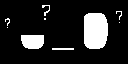
  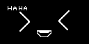
  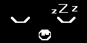
</p>

<p align="center">
  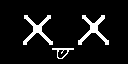
  
  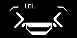
  
</p>

<p align="center">
  <a href="https://VIDAKHOSHPEY22.github.io/Dumirror_Robo/">
    <b>Explore the complete live gallery →</b>
  </a>
</p>

### Face reference

| # | Name | Expression |
|---:|---|---|
| 1 | `normal` | Neutral and relaxed |
| 2 | `pooker` | Mischievous side-eye |
| 3 | `love` | Heart eyes |
| 4 | `touch` | Touch response |
| 5 | `cry` | Crying |
| 6 | `dizzy` | Disoriented |
| 7 | `kiss` | Blowing a kiss |
| 8 | `warm` | Feeling warm |
| 9 | `hot` | Overheated |
| 10 | `chilly` | Feeling chilly |
| 11 | `cold` | Freezing |
| 12 | `angry` | Angry expression |
| 13 | `huh` | Confused |
| 14 | `laugh` | Laughing |
| 15 | `sleepy` | Sleepy |
| 16 | `dead` | Knocked out |
| 17 | `wink` | Playful wink |
| 18 | `lol` | Extreme laughter |
| 19 | `sad` | Sad expression |

---

## Contents

- [About](#about)
- [Real Hardware Demo](#real-hardware-demo)
- [Features](#features)
- [Temperature Expressions](#temperature-expressions)
- [Supported Architectures](#supported-architectures)
- [Requirements](#requirements)
- [Installation](#installation)
- [Wiring](#wiring)
- [Quick Start](#quick-start)
- [Animation Playback](#animation-playback)
- [API Overview](#api-overview)
- [Creating Custom Faces](#creating-custom-faces)
- [Creating Custom Animations](#creating-custom-animations)
- [How the Registry Works](#how-the-registry-works)
- [Memory Considerations](#memory-considerations)
- [Project Structure](#project-structure)
- [Tests and Validation](#tests-and-validation)
- [Contributing](#contributing)
- [Inspiration and Originality](#inspiration-and-originality)
- [License](#license)

---

## About

**Dumirror_Robo** is an open-source Arduino library that brings expressive animated faces to small DIY robots using SSD1306 128×64 OLED displays.

It provides a collection of ready-to-use facial expressions and frame-based animations, allowing makers to build the visual personality of a robot without implementing every expression from scratch.

The library is designed for small microcontrollers and includes features such as:

- 19 built-in static facial expressions
- 10 frame-based animations
- Non-blocking animation playback
- Custom animation support
- Text rendering
- Flash-resident bitmap data using `PROGMEM` where supported
- Selectable face profiles for small AVR boards
- Configurable I2C display pins and address

Dumirror_Robo focuses on the visual layer of a companion robot. You can combine it with sensors, buttons, touch modules, sound systems, and other hardware to create your own interactive projects.

### Minimal example

```cpp
#include <Dumirror_Robo.h>

DumirrorRobo robo(8, 9);

void setup() {
    robo.begin();
    robo.showFaceByName("normal");
}

void loop() {
}
```

---

## Real Hardware Demo

Dumirror_Robo can be used as the expression system of a physical DIY robot.

<p align="center">
  
  <br/>
  <sub>A real hardware demonstration of Dumirror_Robo.</sub>
</p>

### Watch the setup tutorial

<p align="center">
  <a href="https://youtu.be/25PJctTHJlc">
    
  </a>
  <br/>
  <b><a href="https://youtu.be/25PJctTHJlc">▶ Watch the YouTube Tutorial</a></b>
  <br/>
  <sub>Arduino IDE · Library installation · Board configuration · ESP32 setup</sub>
</p>

---

## Features

| Feature | Description |
|---|---|
| 19 Static Expressions | Built-in facial expressions for different moods and reactions |
| 10 Animations | Frame-based animated expressions |
| Non-blocking Playback | Animation updates without requiring the animation itself to block the main application |
| Custom Animations | Support for creating and playing custom frame sequences |
| Text Rendering | Display text as part of your robot interface |
| PROGMEM Storage | Flash-resident bitmap data on supported architectures |
| Face Profiles | Selectable face profiles for small AVR boards |
| Name-based Selection | Display registered faces using readable names |
| Automatic Cycling | Cycle through registered expressions |
| Configurable I2C | Configure SDA, SCL, and display address |
| X-Macro Registry | Centralized registration of faces and animations |
| Arduino Examples | Example sketches for learning and experimentation |

**Memory considerations:** `PROGMEM` allows supported platforms to keep bitmap data in program memory rather than requiring all bitmap assets to occupy RAM. The display framebuffer and runtime objects still require memory. Actual memory usage depends on the target board and configuration.

---

## Temperature Expressions

Five expressions can be used to represent temperature conditions.

<p align="center">
  
  
  
  
  
</p>

<p align="center">
  <b>cold → chilly → normal → warm → hot</b>
</p>

These expressions can be used with temperature sensors such as DHT11, DHT22, or BME280.

### Example

```cpp
float temperature = dht.readTemperature();

if (isnan(temperature)) {
    return;
}

if (temperature > 38) {
    robo.showFaceByName("hot");
}
else if (temperature > 30) {
    robo.showFaceByName("warm");
}
else if (temperature > 20) {
    robo.showFaceByName("normal");
}
else if (temperature > 12) {
    robo.showFaceByName("chilly");
}
else {
    robo.showFaceByName("cold");
}
```

The thresholds above are illustrative. Adjust them according to your sensor and application.

---

## Supported Architectures

The library metadata declares support for the following Arduino architectures:

| Architecture | Target examples |
|---|---|
| AVR | Arduino Uno, Nano, Mega |
| ESP32 | ESP32 development boards |
| ESP8266 | ESP8266 development boards |
| RP2040 | Raspberry Pi Pico and compatible boards |

The library is intended for boards that can communicate with an SSD1306 display over I2C and provide sufficient memory for the selected configuration.

**Compatibility note:** Architecture declarations in `library.properties` describe the library's declared compatibility targets. They do not independently prove physical testing on every board model. Results may vary depending on the board core, compiler, available memory, and display module.

---

## Requirements

### Hardware

- A compatible microcontroller
- SSD1306 128×64 monochrome OLED display
- I2C connection
- Suitable power supply

### Software dependencies

Dumirror_Robo requires:

1. [Adafruit GFX Library](https://github.com/adafruit/Adafruit-GFX-Library)
2. [Adafruit SSD1306](https://github.com/adafruit/Adafruit_SSD1306)

Install both dependencies using the Arduino Library Manager.

---

## Installation

### Arduino IDE

1. Download the library ZIP from the [Releases page](https://github.com/VIDAKHOSHPEY22/Dumirror_Robo/releases).
2. Open Arduino IDE.
3. Select **Sketch → Include Library → Add .ZIP Library**.
4. Select the downloaded ZIP file.
5. Install Adafruit GFX Library and Adafruit SSD1306 through Library Manager.
6. Open an example sketch and select your target board.

### Git

Clone the repository:

```bash
git clone https://github.com/VIDAKHOSHPEY22/Dumirror_Robo.git
```

Place the library in your Arduino libraries directory if you are installing it manually.

### PlatformIO

Add the library and its dependencies to `platformio.ini`:

```ini
lib_deps =
    adafruit/Adafruit GFX Library
    adafruit/Adafruit SSD1306
    https://github.com/VIDAKHOSHPEY22/Dumirror_Robo.git
```

---

## Wiring

Connect the SSD1306 OLED to the microcontroller using I2C.

| OLED Pin | Microcontroller | Description |
|---|---|---|
| VCC | Compatible supply voltage | Power |
| GND | GND | Ground |
| SDA | Board-specific SDA pin | I2C data |
| SCL | Board-specific SCL pin | I2C clock |

**Important:** Check your OLED module's voltage requirements before connecting it. Not all modules support the same power voltage or logic levels.

### ESP32-S3 + SSD1306 + TTP223

<p align="center">
  
</p>

### Arduino Uno + SSD1306 + TTP223

<p align="center">
  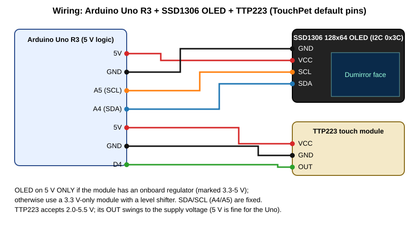
</p>

### Wokwi wiring preview

<p align="center">
  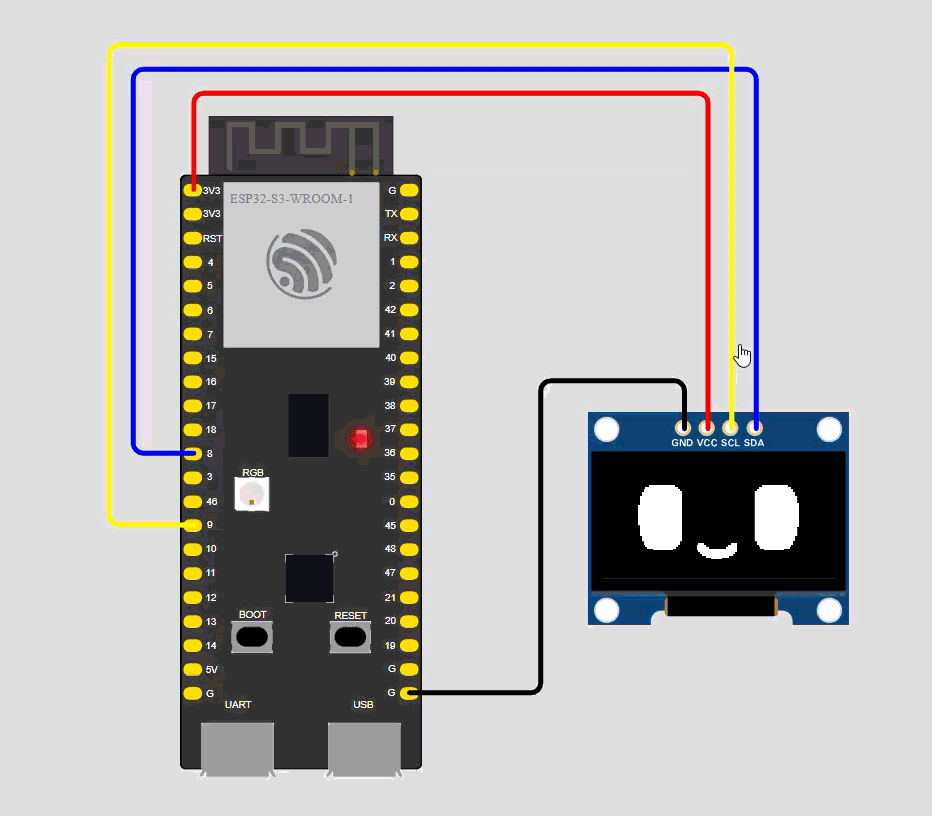
</p>

### Configure the I2C pins

The constructor accepts SDA and SCL pins:

```cpp
DumirrorRobo robo(8, 9);
```

For example, an ESP32 board may use GPIO 21 and GPIO 22:

```cpp
DumirrorRobo robo(21, 22);
```

Use the correct I2C pins for your specific board. On boards such as Arduino Uno, I2C pins are board-defined and should not be assumed to be GPIO 8 and GPIO 9.

### Configure the I2C address

The constructor also accepts an optional display address:

```cpp
DumirrorRobo robo(8, 9, 0x3C);
```

The common SSD1306 I2C address is `0x3C`, but your module may use a different address.

---

## Quick Start

The following example initializes the OLED and displays a static face.

```cpp
#include <Arduino.h>
#include <Dumirror_Robo.h>

DumirrorRobo robo(8, 9);

void setup() {
    Serial.begin(115200);

    if (!robo.begin()) {
        Serial.println("OLED initialization failed!");

        while (true) {
            delay(100);
        }
    }

    robo.showFaceByName("normal");
}

void loop() {
}
```

### Display different expressions

```cpp
robo.showFaceByName("normal");
delay(1000);

robo.showFaceByName("love");
delay(1000);

robo.showFaceByName("angry");
delay(1000);

robo.showFaceByName("sleepy");
delay(1000);
```

### Automatically cycle through registered entries

```cpp
#include <Arduino.h>
#include <Dumirror_Robo.h>

DumirrorRobo robo(8, 9);

void setup() {
    robo.begin();
}

void loop() {
    robo.update(1000);
}
```

The interval passed to `update()` controls the automatic cycling interval.

---

## Animation Playback

Registered animations can be selected by name.

```cpp
robo.showFaceByName("sneeze");
```

Call `updateAnimation()` regularly from the main loop to advance the animation.

```cpp
void loop() {
    robo.updateAnimation();
    delay(10);
}
```

### Non-blocking application structure

For interactive projects, animation updates should run regularly without preventing other application tasks from executing.

For example:

```cpp
void loop() {
    robo.updateAnimation();

    // Read sensors
    // Check buttons
    // Handle other application logic

    delay(10);
}
```

The exact update frequency depends on the animation timing and the needs of your application.

---

## API Overview

The main library interface includes the following operations:

| Method | Purpose |
|---|---|
| `DumirrorRobo(sda, scl, addr)` | Configure I2C pins and display address |
| `begin()` | Initialize the OLED display |
| `showFace(id)` | Display a registered face by numeric ID |
| `showFaceByName(name)` | Select a registered face or animation by name |
| `update(ms)` | Advance automatic cycling |
| `updateAnimation()` | Update the active animation |
| `stopAnimation()` | Stop the current animation |
| `isAnimationPlaying()` | Check animation playback status |
| `faceCount()` | Return the number of registered entries |
| `getName(id)` | Get the name of a registered entry |
| `getBitmap(id)` | Access a registered bitmap pointer |
| `playAnimation(animation)` | Play an animation structure directly |

The current registry contains 29 entries:

- 19 static expressions
- 10 animations

For the exact function signatures and additional functionality, refer to the public header file:

[`src/Dumirror_Robo.h`](src/Dumirror_Robo.h)

Custom animation, text rendering, and face profile interfaces should be used according to the declarations in the installed library version.

---

## Creating Custom Faces

Dumirror_Robo uses a centralized registry to organize its facial expressions.

A typical workflow for adding a static face is:

### 1. Create the bitmap

Create a new header in:

```text
src/faces/face_happy.h
```

Example structure:

```cpp
#ifndef FACE_HAPPY_H
#define FACE_HAPPY_H

#include <Arduino.h>

const uint8_t FACE_HAPPY[] PROGMEM = {
    // Add the 128 × 64 monochrome bitmap data.
};

#endif
```

The bitmap must follow the format expected by the library's drawing implementation.

You can use tools such as:

- [image2cpp](https://javl.github.io/image2cpp/)
- LCD Image Converter

Make sure the generated bitmap format matches the existing face assets.

### 2. Include the header

Add the new header to the main library header:

```cpp
#include "faces/face_happy.h"
```

### 3. Register the face

Add the appropriate entry to:

```text
src/faces.def
```

Follow the existing static face registration format:

```cpp
X(FACE_HAPPY, FACE_HAPPY_ID, "happy")
```

The registry is used to generate the corresponding identifiers and lookup information.

### 4. Add a preview image

Save a preview image at:

```text
images/oled-128x64-happy.png
```

The image can also be included in the live gallery.

---

## Creating Custom Animations

Animations are made from sequences of monochrome frames.

A typical animation contains:

- Individual frame bitmaps
- A frame sequence
- Frame durations
- A frame count
- A loop configuration

Create a new animation header following the structure of the existing animation headers.

For example:

```text
src/faces/anim_happy.h
```

Include the new header in the main library header and register it in `src/faces.def`.

Follow the existing `X_ANIM(...)` registration format and use the actual identifiers, frame count, and playback configuration defined by your implementation.

Finally, add a GIF preview:

```text
images/animations/happy.gif
```

Before submitting a new animation, check that the frame data, timing, registration, and preview are consistent.

---

## How the Registry Works

The library uses an X-Macro registry.

The central registry is located at:

```text
src/faces.def
```

It provides a shared list of registered faces and animations.

By including this registry with different macro definitions, the library can generate related structures such as:

- Face identifiers
- Bitmap lookup tables
- Name lookup tables
- Animation references

This approach helps reduce duplicated registration information and keeps related structures synchronized.

Compile-time checks can also detect certain inconsistencies before the firmware is uploaded to the board.

---

## Memory Considerations

Small microcontrollers have limited RAM and flash storage.

Dumirror_Robo uses flash-resident data techniques such as `PROGMEM` on supported platforms to reduce unnecessary RAM usage.

Memory behavior can differ between architectures and board configurations.

The display framebuffer and runtime objects still require memory. Actual memory usage depends on the target board, configuration, and display library implementation.

For more information, see the source code and configuration files in `src/`.

---

## Project Structure

```text
Dumirror_Robo/
│
├── CHANGELOG.md
├── README.md
├── LICENSE
├── library.properties
├── keywords.txt
├── index.html
│
├── docs/
│   ├── API.md
│   ├── ANIMATIONS.md
│   ├── ANIMATION_DIFFS.md
│   ├── COMPATIBILITY.md
│   ├── MEMORY.md
│   ├── STYLE_SHEET.md
│   ├── TROUBLESHOOTING.md
│   └── WIRING.md
│
├── src/
│   ├── Dumirror_Robo.h
│   ├── Dumirror_Robo.cpp
│   ├── Dumirror_Config.h
│   ├── faces.def
│   │
│   ├── faces/
│   │   ├── face_normal.h
│   │   ├── face_pooker.h
│   │   ├── face_love.h
│   │   ├── ...
│   │   ├── face_sad.h
│   │   ├── anim_sneeze.h
│   │   ├── anim_blink.h
│   │   ├── ...
│   │   └── anim_chew.h
│   │
│   └── internal/
│       └── Dumirror_Storage.h
│
├── examples/
│   ├── AnimatedFaces/
│   ├── BasicFace/
│   ├── CustomAnimation/
│   ├── CycleFaces/
│   ├── Mochi_Finnish_Dinner_Date/
│   └── TouchPet/
│
├── images/
│   ├── mochi.gif
│   ├── oled-128x64-normal.png
│   ├── ...
│   ├── oled-128x64-sad.png
│   │
│   ├── animations/
│   │   ├── sneeze.gif
│   │   ├── blink.gif
│   │   ├── look_left.gif
│   │   ├── look_right.gif
│   │   ├── smile_big.gif
│   │   ├── heartbeat.gif
│   │   ├── sleep_breath.gif
│   │   ├── wake_up.gif
│   │   ├── hiccup.gif
│   │   └── chew.gif
│   │
│   └── wiring/
│       ├── wiring_esp32s3_ssd1306_ttp223.svg
│       ├── wiring_uno_ssd1306_ttp223.svg
│       └── wokwi_wire.gif
│
├── tests/
│   ├── README.md
│   └── host/
│       ├── check_examples.sh
│       ├── run_tests.sh
│       ├── test_dumirror.cpp
│       ├── touchpet_sim.cpp
│       └── shim/
│
└── tools/
    ├── gen_keywords.py
    ├── mochi.ino
    └── validate_library.py
```

This is a simplified overview. Additional source files and development utilities are included in the repository.

---

## Tests and Validation

The repository includes host-side tests and validation utilities.

Relevant files:

```text
tests/
├── README.md
└── host/
    ├── check_examples.sh
    ├── run_tests.sh
    ├── test_dumirror.cpp
    ├── touchpet_sim.cpp
    └── shim/
```

Additional validation tools are available in `tools/`.

Host-side tests help check library logic and examples in a simulated environment. They do not replace compilation and hardware testing on every supported microcontroller.

---

## Contributing

Contributions are welcome.

You can help improve Dumirror_Robo by submitting:

- Original facial expressions
- New animations
- Bug fixes
- Memory optimizations
- Architecture compatibility improvements
- Documentation updates
- Example projects
- Hardware demonstrations

### Contribution guidelines

1. Keep pull requests focused.
2. Follow the existing code style.
3. Use original artwork for new expressions.
4. Follow the existing face and animation registration conventions.
5. Include relevant hardware and software information when reporting compatibility.
6. Check image dimensions and animation timing before submitting assets.

For bug reports, include:

- Microcontroller model
- Board package version
- Arduino IDE or PlatformIO version
- OLED controller and I2C address
- Compilation output or relevant serial logs

---

## Inspiration and Originality

Dumirror_Robo was inspired by the broader idea of small expressive companion robots, including the **Dasai Mochi**.

We appreciate the creativity behind these products. However, Dumirror_Robo is an independent open-source project.

**Dumirror_Robo is not a Dasai Mochi clone and is not affiliated with Dasai.**

The library is developed independently. Its code and facial assets are intended for makers who want to learn, experiment, and build their own expressive robots.

The project does not include proprietary Dasai firmware or assets.

Our goal is to make expressive OLED displays more accessible to people who enjoy building small interactive devices with microcontrollers.

---

## License

Dumirror_Robo is released under the **MIT License**.

Copyright (c) 2026 VIDA KHOSHPEY

You are free to:

- Use the library
- Modify the source code
- Distribute copies
- Include it in personal projects
- Use it in commercial projects

The MIT license notice must be included in copies or substantial portions of the software.

See the [`LICENSE`](LICENSE) file for the complete license text.

---

<p align="center">
  <b>Made with ♡ by the Dumirror Team</b>
  <br/>
  <a href="https://github.com/VIDAKHOSHPEY22/Dumirror_Robo">GitHub Repository</a>
  ·
  <a href="https://VIDAKHOSHPEY22.github.io/Dumirror_Robo/">Live Gallery</a>
  ·
  <a href="https://youtu.be/25PJctTHJlc">YouTube Tutorial</a>
</p>

<p align="center">
  If you build something with Dumirror_Robo, consider starring the repository and sharing your project.
</p>